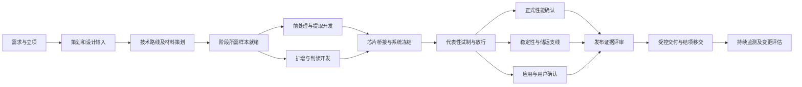

# 试剂/芯片项目母版分析与改进建议

分析日期：2026-10-13（Asia/Shanghai）  
对象：服务器导出的 `TPL-REAGENT-MASTER`，13 阶段、65 任务  
源码基线：`24679d2c1e8992c39c0b9b79748bb539274fc4f7`  
性质：导出资料分析、定向源码核对、方案建议。未修改母版、业务代码或数据库，未运行产品测试、构建或部署。

## 1. 结论与定位

当前母版已经覆盖需求、方案、提取、扩增、芯片集成、性能、稳定性、生产质控、应用验证和交付，适合作为非医疗分子检测芯片研发的基础。首要改进是把这些活动组织成可以按条件裁剪、按证据放行、按版本追溯的过程，并让系统完整保留这些信息。

**不要把这份母版直接认定为三类 IVD 注册全流程。** 导出中的模板描述明确写的是“参考三类 IVD 的设计开发、风险控制、性能验证与文件留痕思路轻量化落地”，应用对象为海关检疫、疾控筛查、食品安全、环境、水产、宠物等非医疗分子检测芯片产品。上述场景标签本身也不能决定监管属性，仍须结合样本、预期用途、使用者及结果用途判断。采用人体样本并用于医疗目的时，应另行确定适用的 IVD 路线。[《体外诊断试剂注册与备案管理办法》第三条](https://www.samr.gov.cn/zw/zfxxgk/fdzdgknr/fgs/art/2023/art_a87eaa0612684228a20d4018338f9266.html)

建议保留“通用研发核心”，分别配置非医疗应用模块、平台技术模块和医疗注册模块。医疗模块按目标地区和具体产品要求配置，不通过把内部开发等级选为 C 来替代监管分类。

### 资料导航

- [原始母版导出](inputs/template-export.json)：完整保留原始 config 和结构化阶段、任务、角色。
- [服务器源码上下文](inputs/source-context.json)：服务器报告的 HEAD 与七个文件哈希。
- [原导出说明](inputs/EXPORT_NOTE.md)：执行者关于导出方法和限制的陈述，未改写。
- [65 项任务逐项建议](task-review.csv)：每行对应一项原任务，含保留/调整方向、建议交付物、验收及前置条件。
- [资料核对摘要](evidence-summary.json)：文件哈希、数量和字段覆盖的本地复算结果。

## 2. 已核对的事实与证据边界

输入为用户提供的 `rdpms-template-export-20261013-110209.tar.gz`，SHA256 为 `c9c58550c0e9ec13fc4821ec6dc1286f3639634dbd5a0483c49f127a8ab85480`。

已在本地核对：

| 项目 | 实际结果 | 意义 |
|---|---|---|
| 模板 | `e93df987-dfb6-4184-88e9-a6e7ffce5aaf` / `TPL-REAGENT-MASTER` | 与截图名称和编号匹配 |
| config 原始类型 | JSON 字符串；可解析 | 不能按对象直接读取子字段 |
| config 与结构化表 | 均为 13 阶段、65 任务；对应阶段及任务的 ID、名称、顺序匹配 | 数量一致，但字段完整性不一致 |
| 原始中间快照 | 原 config 和阶段/任务/角色与主导出对应值一致 | 导出包内可相互核对 |
| 源码 | 服务器报告 HEAD 与本地 HEAD 相同；7/7 文件哈希匹配 | 当前本地相关源码可用于解释导出 |
| 结构化任务交付物 | 65/65 有 `expectedDeliverable` | 不能把现状描述成“没有交付物” |
| 结构化任务描述、监管备注、角色映射 | `description`、`regulatoryNotes`、`assigneeRoleCode` 各 0/65 非空 | 执行方法及责任分配尚未在这些字段表达 |
| 结构化适用性 | 56 REQUIRED、9 CONDITIONAL | 已有条件裁剪意图，但未形成明确决策规则 |
| config 任务 | 仅 id/title/priority/estimatedDays/role/source/enabled；65/65 的 role 为 member | 缺少结构化表的交付物、适用性、任务类型等信息 |
| config 阶段信息 | 0/13 配置 phaseInfo；events、eventTemplates 均为空 | 当前导出中没有节点退出条件和事件配置 |
| 里程碑 | config.milestones 为空；结构化表 p1/p7/p11 标记 isMilestone | “M0–M7”任务标题不等于实际配置八个门禁 |
| 模板描述 | 写“13 阶段 57 项任务”；实数为 65 | 描述已过时，应自动统计或避免固化数字 |

本轮没有连接服务器或数据库，没有核验真实项目实例或审批记录。数据库只读事务及服务未变更，是导出执行者的陈述，不是本轮独立运行事实。仅凭 `BEGIN READ ONLY` 也不能独立证明多条查询共用同一 MVCC 快照；如后续需严格快照证明，应明确隔离级别或单语句读取方式。本次确认的是导出包内部一致性。

## 3. 现有 13 阶段逐阶段评估

以下“缺少”均指本次导出的母版表达不足，不推断企业其他 QMS 文件或实际研发活动不存在。

| 阶段 | 任务数 | 可保留内容 | 需要改进的重点 |
|---|---:|---|---|
| p1 立项与需求确认 | 7 | 应用场景、价值、声称边界和 Go/No-Go | 把预期用途、样本/靶标范围、结果用途、拟交付状态写成明确设计输入；立项审批依赖输入完成，不能只凭任务勾选 |
| p2 项目管理机制 | 6 | 职责、预算、风险、变更和 M0–M7 | 建立机制可作为初始工作包；风险、变更、计划更新必须贯穿全程，不在此阶段一次性结清 |
| p3 技术方案设计 | 6 | 靶标、引物、前处理、芯片适配 | 加入关键原材料及对照品策略、可测量设计输入、验证总体计划；明确哪些需求由哪个试验支持 |
| p4 样本收集 | 3 | 采集接收和入库 | 区分开发样本、验证样本及参考材料；建立来源/真值/浓度依据、保存时长、冻融及样本谱；按后续里程碑分批就绪 |
| p5 片前处理验证 | 3 | 提取方案及抑制物评价 | 建议改名“样本前处理与核酸提取开发”，注明片外/片内边界；增加基质、输入量、回收与抑制评估、携带污染及流程兼容性 |
| p6 片外扩增优化 | 5 | 筛选、体系、程序及初评 | 明确提取内控/扩增内控、阴阳对照、判读、复测及污染控制；与 p5 有条件并行迭代，最终使用统一样本链验证 |
| p7 芯片集成联调 | 5 | 液滴/磁珠、温控/荧光、算法和冻结 | 增加显式的片内外桥接报告；冻结范围应覆盖试剂、芯片、前处理、程序、算法和操作文件，不能仅冻结芯片结构 |
| p8 分析性能验证 | 8 | 已有 LoD、特异性、重复性、干扰与报告 | 拆清 A/B/C 任务选择规则，预先批准方案和判定标准；正式确认使用代表性批次及冻结版本；包容性、临界结果、无效率、稳健性按声称纳入 |
| p9 稳定性验证 | 4 | 实时/加速、开封、上机、储运 | 记录观察周期与数据切点；在代表性产品就绪后启动长期支线，避免全串行；工时不能换算成已证明的货架期 |
| p10 小试生产与质控 | 4 | BOM、过程 QC、放行标准与批间一致性 | 工艺策划前移；正式性能及稳定性确认前，应有代表性试制产品和放行证据。探索样品可先做筛选，需区别证据用途 |
| p11 应用验证与客户试用 | 5 | 真实样本、对比方法和使用体验 | 方案、对比方法适用性、盲法/随机化需求、冲突处理和统计先确定；用户喜好反馈与方法性能证据分别结论 |
| p12 产品发布评审 | 4 | 发布决策和版本历史 | 发布前必须已有受控说明书、标签、SOP、质量文件；版本管理贯穿全程；“上市后跟踪”迁至发布后的持续活动 |
| p13 文件归档与交付 | 5 | 四类文件和知识库 | 文档随研发形成并版本化；发布前完成受控文件批准，发布后归档已批准证据及移交，避免文件首次编制晚于发布 |

### 3.1 最值得优先改的五处流程关系

1. **代表性试制前置。** 现在 p8 性能、p9 稳定性在 p10 小试生产之前。母版未表达这两类试验使用何种批次。建议把探索性性能初评留在 p6/p7，把支持发布声称的正式确认放在代表性工艺/批次就绪之后。这不是认定旧试验无效，而是补齐样品代表性和证据用途。
2. **文件批准前置。** p12 的发布交付物要求“文件完整”，p13 却安排产品文件编制。应明确 p13 是归档已批准文件；说明书、标签、SOP 及质量文件须在发布前完成并批准。
3. **稳定性改为长期支线。** p9 结构化阶段为 30 天，config 中“试剂与芯片稳定性”任务为 5 天。两者都不是有效期结论的依据。单独管理人时、观察日历周期、时间点和当前可支持声称，发布决策引用当时已有数据。
4. **管理工作贯穿全程。** p2 的风险/变更不能随着阶段完成而停止；p12 的版本管理和上市后跟踪也不适合一次性完成。建立持续任务或受控记录，在各门禁复核。
5. **建立真实前置关系。** 需求→设计输入→方案→试验方案→执行→分析→报告→审核应有依赖。当前画布将同阶段任务统一展开成并行分支，不能据此认定“方案设计与方案审批可同时完成”。

### 3.2 A/B/C 应如何调整

导出中有“开发等级划分”和 A 类最低验证/C 类增强验证，但没有给出可独立执行的等级选择、升级及任务启用规则。不要把内部 A/B/C 与医疗器械一/二/三类混用。

建议分三项登记：

- **应用/监管路线**：非医疗具体用途，或适用地区的医疗注册路线；未确定时登记未知并限制声称。
- **开发变化范围**：新平台/新产品、靶标或样本扩展、配方/工艺/算法变更、已有产品受限验证。
- **证据强度**：探索、标准确认、增强确认。可保留 A/B/C 名称，但必须明确其定义，升级触发和审核人。

共同发布底线不按预算减免：预期用途明确、支持声称的证据、结果判读及有效性规则、已知风险控制、追溯到产品版本、适用的质控与交付文件。探索级数据只支持其已验证范围，不自动获得广泛对外用途。

条件任务至少需要 `适用条件 / 判定人 / 判定依据 / 决定 / 批准记录`。不适用应有理由，不等同于完成。扩展靶标、样本、仪器、用户或储运边界时重新评估，不沿用旧等级自动减项。

### 3.3 芯片平台需要独立桥接模块

当前 p7 已要求片内外 Ct 差异评估，但没有把提取、扩增、平台效应的分离比较列为明确工作包。现有独立任务库 `backend/src/data/taskTemplateSeed.js:663` 已有 A/B/C/D 桥接思路，可复用后细化；建议改称 E0–E3，避免与开发等级 A/B/C 混淆：

| 组别 | 组合 | 主要回答的问题 |
|---|---|---|
| E0 | 片外提取＋管式扩增 | 已确认的参照工作流程是什么 |
| E1 | 同一提取物＋芯片扩增 | 反应载体及平台转化对检测的影响 |
| E2 | 片内提取产物＋管式扩增 | 片内提取、抑制物和可获得模板的影响 |
| E3 | 片内提取＋芯片扩增 | 完整流程的结果、失败及运行表现 |

具体是否可取出片内提取产物须按平台评估，不适用时采用有依据的替代设计。比较前明确同一样本/平行等分、输入量、洗脱体积、反应模板量、批次、运行及算法版本；跨仪器 Ct 差异不能直接当成提取效率。重点包括低载量样本检出、无效/失败、污染及结果一致性，指标和界限由方案确定，不预设统一的 ΔCt 合格值。

## 4. 当前系统承载母版的确认问题

此节是静态调用链结论，未运行 HTTP、数据库或浏览器复现。优先级用于母版改进排期：高=会改变下发要求或放行含义；中=影响一致性、复制或计划；低=描述维护。不是对整套产品的安全等级评价。

### SYS-01（高）：交付物及条件适用性没有完整传递到项目任务

**证据：** `inputs/template-export.json` 的 `structuredPhases[*].tasks[*]` 有 65 个交付物、9 个 CONDITIONAL；同 ID 的 `template.configParsed.phases[*].tasks[*]` 均缺这些字段。

**路径：**

1. `backend/src/routes/projectTemplates.js:28` 优先选择 config。
2. `projectTemplates.js:75` 对缺失字段把 applicability 补成 required，taskType/regulatoryPriority 补空，不从结构化同 ID 任务补全；也未输出 expectedDeliverable。
3. `projectTemplates.js:384` 的 apply 返回计划中没有 expectedDeliverable。
4. `frontend/src/components/CreateProjectModal.tsx:107` 本地解析只看 content，而当前列表返回 config；其后 `:318` 使用 apply 兜底。
5. `CreateProjectModal.tsx:324` 和 `:455` 再次只保留简化字段，不提交交付物、适用性、任务类型、模板任务身份等。
6. `backend/src/routes/projects.js:103` 缺省适用性为 REQUIRED、交付物为空；`:432` 使用这些入参创建任务。

**已支持影响：** 按当前创建弹窗链路，模板的交付物和条件属性不能传递为相同含义的项目任务；不是“数据库里没写”，而是读写链路投影丢失。没有读取真实项目实例，不能据此认定所有历史项目都已受影响。

**建议：** 确定一个有 schema/version 的规范模板命令；编辑/预览/复制/实例化使用同一解析与校验规则。优先结构化领域字段，或规范 JSON 再生成结构化投影，均可，但不能让两套结构各自决定业务。项目创建由后端按已发布模板版本生成快照；裁剪覆盖必须明确记录。

**未来验收：** 指定含交付物和 CONDITIONAL 的真实模板任务，完整保存、重开、预览、复制、创建项目后核对持久行；适用性依据、交付物、角色、任务类型及追溯身份不丢失。合法与不适用两条路径分别验证。

### SYS-02（高）：节点信息、审批类型和事件配置不能完整读回

**证据：** 当前导出 p1 的 `type=approval`；全部阶段目前未配置 phaseInfo/events。`TemplateEditor.tsx:1570` 可保存 phaseInfo、allowSkip、type、events，但 `projectTemplates.js:63` 的返回投影不包含这些字段；详情 `:148` 用该投影覆盖 phases。编辑器 `TemplateEditor.tsx:984` 优先使用 phases，`:1046` 缺省成 normal；保存再次写入简化结果。

**影响：** p1 的审批类型不能按原值经该详情链路读回；未来填写节点退出条件和事件后，仍存在读回丢失及后续覆盖的路径。因此先完善母版填写项、却不修读取合同，可能让内容无法稳定保存。当前没有已填 phaseInfo 的导出，不声称发生过历史删除。

**建议/验收：** 节点业务字段完整往返保存；画布坐标与审批条件区分；一个有非空目标、退出条件、审批类型和事件的节点保存重开后逐字段一致。未实现的事件功能明确标为配置草案。

### SYS-03（中）：复制与已有项目套用读取的不是同一完整模板

**证据：** `projectTemplates.js:280` 复制 metadata、roles、阶段/任务行，但 create 不复制 config。`projects.js:794` 的 apply-template 遍历结构化阶段/任务；编辑更新 `projectTemplates.js:202` 只更新模板 config 等字段，未同步阶段任务行。

**反证与边界：** 本次两套数据的 ID、标题和顺序相同，不能说它们已在数量上分叉。复制流程会保留结构化任务的交付物，也不等于副本完全为空。但 config 中的类型/连线/事件/阶段信息等没有复制路径；后续仅编辑 config 后，两种应用方式可能生成不同内容。

**建议/验收：** 复制、创建新项目、对已有项目套用共享同一模板版本；重建内部 ID 时重映射连线及引用，保留来源。三条路径逐字段对照，已有项目套用应先预览差异，禁止默认覆盖已执行记录。

### SYS-04（高）：流程图不是证据放行门禁

**证据：** `ProcessFlowDiagram.tsx:108` 将同阶段全部任务统一扇出并连接后继，不读取实际任务依赖。`backend/src/routes/phases.js:112` 和 `:147` 在权限检查及状态归一后更新阶段状态，没有核对前置任务、交付物或审批结论。

**已有保护：** 阶段更新仍有动作权限及项目能力检查；并非任何人都可更新。但权限允许不等于证据充分。

**建议：** 先定义 M0–M7 的证据清单及批准角色，再将阶段放行作为后端命令处理。普通任务完成、审核通过、阶段放行分别登记。需要例外放行时保存风险、期限、批准及待补项，不静默跳过。

**未来验收：** 授权用户在缺交付物/审核未过时不能放行；证据满足且有权限时可以放行；审核人与执行人规则、并发修改及证据版本变化重新审核的行为按批准合同验证。

### SYS-05（中）：工时、日历及依赖含义不一致

**证据：** 结构化阶段 plannedDurationDays 合计 240，config 任务 estimatedDays 合计 154，结构化任务 estimatedHours 合计 1200。数字属于不同字段，不能互换，也不能据此认定项目应为 240 天或 154 天。`projectTemplates.js:399–414` 按任务逐一累加日期；画布却将同阶段任务画为并行，未依据真实依赖计算。已有项目套用 `projects.js:819` 使用阶段工期计算同阶段各任务截止日。

**建议：** 区分人时、任务历时、外部等待、稳定性观察周期；排期基于任务依赖、资源日历、前置资源及时间点。允许估算未知，不给未知项填统一 3 天造成假精确。

**未来验收：** 用已批准的小型串并行案例核对两种套用路径的任务开始/截止与门禁日期；长期观察不被工时换算缩短。

### SYS-06（中）：角色及版本追溯没有表达成可执行合同

**证据：** 模板有 4 个泛角色；结构化 65 个 assigneeRoleCode 全为空；config 全为 member。创建弹窗 `CreateProjectModal.tsx:465` 把所有下发任务负责人设为 managerId。`schema.prisma:700` 的 ProjectTemplate 没有专用发布版本字段，当前 ProjectTemplate.config 可扩展，但本次导出也没有版本快照标识；项目创建链路未产生完整不可变模板快照。

**建议：** 增设产品/需求、分子、芯片、软件算法、质量、生产、应用、法规（条件启用）职责映射，允许一人兼任但区分责任与审批。模板发布为不可变版本，项目引用其版本及裁剪记录；母版更新不自动重写在研项目。

**未来验收：** 同一角色可映射到不同项目成员；未分配时显示待分配；关键审核有明确权限。旧项目能重现创建时的模板及要求，不因母版改名或更新漂移。

## 5. 建议的母版组织：通用核心＋模块＋持续工作

为便于迁移，可以保留 13 个主阶段，但调整其职责和顺序；数量并非强制要求。

| 建议编号 | 阶段 | 关键产出及放行要点 | 原阶段去向 |
|---|---|---|---|
| T01 | 需求、用途与立项 | 需求/声称/用途边界、初始风险、Go/No-Go | p1 |
| T02 | 开发策划与设计输入 | 可测量指标、职责、计划、适用模块、验证裁剪依据 | p2＋补充设计输入 |
| T03 | 技术路线与关键材料策划 | 体系/芯片方案、关键物料与供应策略、参考品与对照策略、验证总体计划 | p3 |
| T04 | 样本与参考材料就绪 | 开发/确认样本分组、真值依据、样本追溯及阶段就绪标准 | p4；供应支线持续 |
| T05 | 前处理与提取开发 | 推荐流程、基质及抑制/污染/兼容性数据 | p5 |
| T06 | 扩增、内控与判读开发 | 体系/程序/内控/判读/复测规则、片外可行性结论 | p6；与 T05 条件并行 |
| T07 | 芯片集成、桥接与系统冻结 | 片内外分离评估、完整系统结果、系统配置基线 | p7 |
| T08 | 工艺转化与代表性试制 | 受控工艺、批次、来料/过程/成品检验及放行 | p10 前移 |
| T09 | 正式分析性能确认 | 预先批准方案、代表性批次、统计/偏差/报告、需求追溯 | p8 |
| T10 | 稳定性、包装与储运确认 | 适用条件下的时间点数据、当前声称可支持范围 | p9；长期支线可从 T08 启动 |
| T11 | 真实样本应用与用户确认 | 用途适配、比较方法、用户任务及异常闭环 | p11 |
| T12 | 发布准备与批准交付 | 文件受控、未决风险、生产/支持就绪、批准的发布边界 | p12＋p13 发布前文件 |
| T13 | 研发结项、移交与持续跟踪建立 | 证据归档、交接、监测计划、反馈负责人及复审机制 | p13＋p12 后续活动 |

风险管理、变更控制、版本与文档、样本资源、供应链、问题/CAPA、法规更新为贯穿活动。若已有外部 QMS，RDPMS 优先保存文件版本和审核引用，无需再造整套质量系统。

图表示建议的证据关系，并非强制所有验证全部同步启动。应用验证的启动条件、长期稳定性在发布时必须具备哪些数据，应按用途、风险和适用要求预先批准。稳定性支线连入评审表示审查已有数据与声称相符，不等于所有长期观察点必须在首次发布前结束。

## 6. M0–M7 建议放行点

以下为方案建议，尚未批准或实施。各角色可以兼任，但关键评审须明确谁提供证据、谁批准及需要何种独立审核。

| 门禁 | 最小证据 | 建议责任/批准 |
|---|---|---|
| M0 立项 | 用途、需求来源、声称边界、资源/风险初评 | 产品/项目提交；研发负责人批准；质量/法规按适用性会签 |
| M1 设计输入基线 | 可测量指标、验证方法、样本与材料策略、适用任务、计划 | 技术/产品提交；质量和相关专业审核 |
| M2 片外可行性 | 提取及扩增的联合数据、内控/判读初版、风险与资源复评 | 分子/前处理提交；技术负责人批准 |
| M3 系统设计冻结 | 试剂/芯片/程序/算法/SOP 一致配置、桥接报告、变更规则 | 跨专业评审；质量核对证据基线 |
| M4 工艺与批次就绪 | 代表性试制、关键物料及工艺、检验/放行记录 | 生产/质量提交；授权质量角色批准批次用途 |
| M5 验证证据充分 | 性能/应用/稳定性已有数据、偏差处理、需求追溯及限制 | 验证负责人提交；技术/质量审核 |
| M6 发布 | 文件、声称、生产/支持就绪、未决风险与用途批准 | 产品/质量/业务授权角色；医疗路线另核上市条件 |
| M7 结项移交 | 已批准文件清单、归档、移交、监测计划及未决行动负责人 | 项目提交；接收方确认，项目负责人结项 |

门禁状态建议区分：未提交、审核中、通过、有条件通过、不通过、不适用。任务完成率不能替代门禁通过率；有条件通过应带明确范围、期限与不得逾越的发布限制。

## 7. 任务的统一执行规格

在现有 65 项任务上补齐以下内容，优先重要任务，不先追求增加总数：

1. 输入与前置条件：需求/方案/样本/批次/版本。
2. 适用条件：何种用途或变更触发，谁决定不适用。
3. 执行方法：引用受控 SOP/试验方案及版本。
4. 产出：原始数据、处理过程、报告、偏差及文件版本。
5. 完成标准：可核对的结果及预先批准判定规则。
6. 职责：执行、复核、批准及项目内映射。
7. 依赖与时间：工作量、日历、外部等待、观察点分开。
8. 追溯：需求→风险→控制措施→验证→结论→发布声称。

例如“灵敏度与检出限（LoD）”不能以“上传一个报告”完成。应引用明确的靶标/样本基质/产品及算法版本、参考材料浓度依据、方案、重复与统计安排、原始结果及预定判定标准；若最终声称变更，需重新审查证据覆盖。这里不规定所有产品统一的批次数、样本量或阈值，医疗路线的强制要求另列。

“原始数据”至少能追到样本、材料/试剂/芯片批次、仪器/软件版本、操作者/日期、原始文件、算法参数、异常与排除原因。RDPMS 可保存受控索引和关联，不必替代实验数据系统存储全部原始文件。

## 8. 若未来确实用于中国大陆三类 IVD

这是条件分支，不是本轮对非医疗母版的统一整改要求。

应新增适用产品分类、注册策略、标准/指导原则版本、产品技术要求及检验、临床评价路径、质量体系核查准备、注册提交补正和获批版本边界。医疗 IVD 路线不能以“客户试用报告”直接替代临床评价；是否免临床试验需按适用条件判断，免试验仍存在相应评价工作。有关研制、检验及临床评价要求见[《体外诊断试剂注册与备案管理办法》第二十七至三十八条](https://www.samr.gov.cn/zw/zfxxgk/fdzdgknr/fgs/art/2023/art_a87eaa0612684228a20d4018338f9266.html)。

注册资料应另建目录与证据映射，不能把非医疗发布评审名称改为“注册评审”后直接复用。[2021 年第 122 号公告及附件目录](https://yjj.sh.gov.cn/qtgzwj/20231109/c6035982397e472e99f8b8ac0a770b34.html)

稳定性模块要按目标产品细化，并维护指导原则版本；已有[2025 年第 4 号稳定性研究指导原则发布信息](https://www.ydcmdei.org.cn/article/599)。本报告未逐项审定其全文，不把该发布页当作某个具体试验设计已经合规的证明。

时点注意：截至本报告日期 2026-10-13，2026-11-01 是已公布的新修订生产质量管理规范相关实施切换节点，未来跨越该日期的医疗项目需纳入版本策划；不能把未来要求写成已经生效，也不能把征求意见稿当最终规则。[国家药监局实施通知](https://www.nmpa.gov.cn/xxgk/fgwj/gzwj/gzwjylqx/20260915163938138.html)

## 9. 分阶段改进顺序与验收建议

### 第一阶段：先让现有要求不丢失

- 统一模板读写和实例化合同，解决 SYS-01/02/03。
- 保留原始导出，建立新版草案；旧模板和在研项目不批量改写。
- 修正 57/65 说明漂移；显示结构化字段及其完整性。
- 验收保存重开、复制、新建项目、已有项目套用的一致性。先证明合法完整模板成功，再验证条件裁剪和拒绝例；检查持久化字段，而不是只看画布。

### 第二阶段：完善母版内容和责任

- 按 65 项逐项建议补输入、交付物、标准、角色及条件。
- 落实代表性试制前置、文档批准前置、管理持续化、稳定性支线。
- 选取一个具体非医疗产品及一个变更/扩展项目，人工走读全部适用任务，确认没有无理由减项或重复验证。
- 形成经负责人审核的 M0–M7 和 A/B/C 裁剪矩阵。这里只提出批准对象，不自行签署。

### 第三阶段：实现证据放行与版本追溯

- 实现后端放行命令、证据/审批版本引用、角色映射、模板发布快照及项目裁剪记录。
- 根据真实依赖排期；分别管理风险、偏差与变更的关闭。
- 验收证据不足拒绝、证据充分成功、版本变化触发重新审查、例外放行范围和并发情况；保持合法权限链有效。

### 第四阶段：增加专用子模板

- 非医疗食品/水产/环境/动物等按具体样本及用途配置验证模块。
- 常规管式试剂、芯片一体化、多靶标、软件/算法及关键变更配置专属模块。
- 中国大陆或澳门医疗注册分别建立适用路线，不混用地区要求。
- 先确认每个模块的输入、继承版本、差异和验收，不把所有模块叠加到每个项目。

## 10. 本轮交付与后续最小决策

本轮新增分析资料，未实施上述修复；所有建议都是待审方案。未使用真实账号、样本或实验结果；未运行测试/数据库/浏览器，未 SSH 访问服务器，未提交或部署。

后续只需先确认两点：

1. 通用母版是否继续以非医疗分子检测芯片研发为主要对象，医疗注册另设模块。
2. 内部 A/B/C 的目标定义，以及哪些产品/声称绝不能按低等级减项。

确认后可将本报告转成新版母版字段规范与有边界的实施任务。建议优先修模板信息传递，再录入大量新内容，避免改好的业务要求再次丢失。
